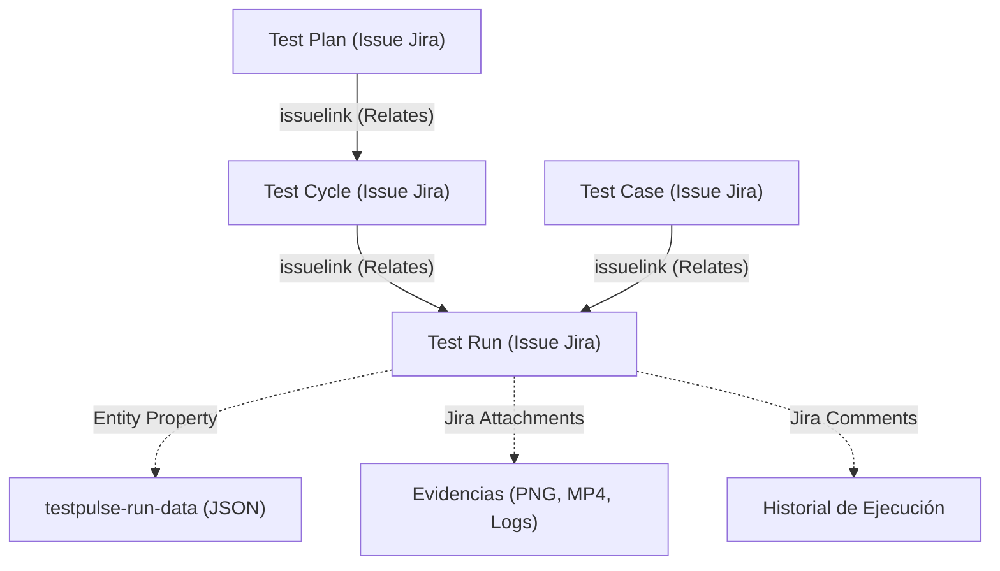
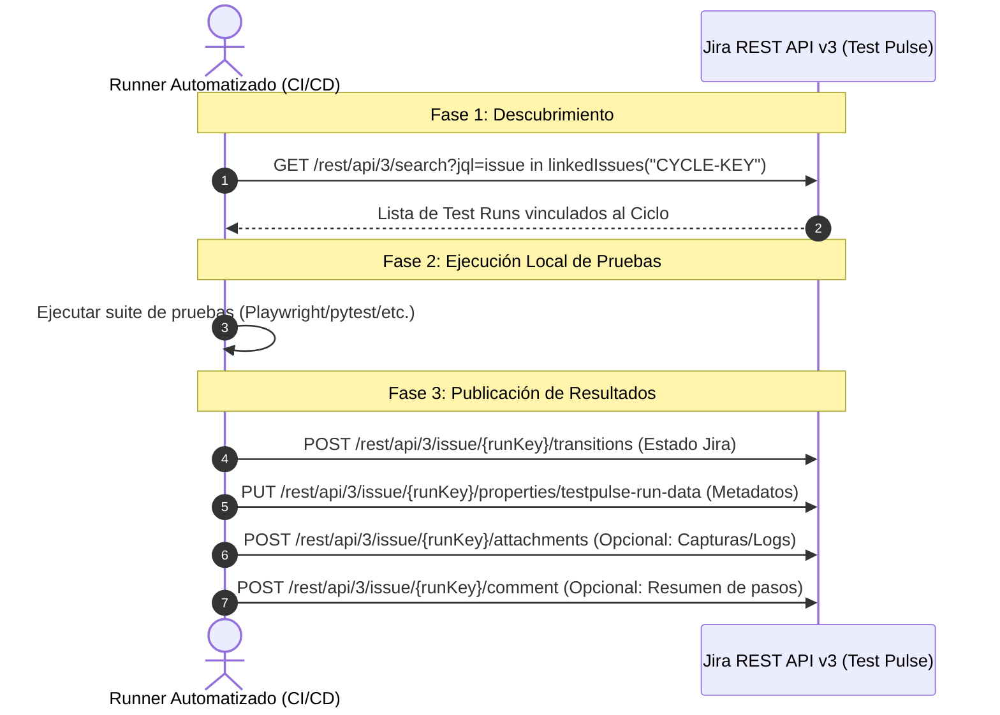

# 🚀 Guía Técnica de Integración: Test Pulse & Automatización de Pruebas

Esta guía proporciona las pautas técnicas y especificaciones de API necesarias para que los equipos de automatización QA / SDET conecten sus frameworks de pruebas (Playwright, Cypress, Selenium, pytest, JUnit, Postman, Robot Framework, etc.) o pipelines de CI/CD (GitHub Actions, GitLab CI, Jenkins) con **Test Pulse** en Jira Cloud.

---

## 1. Arquitectura y Modelo de Datos de Test Pulse

Test Pulse opera **de forma nativa sobre Jira Cloud**. No utiliza una base de datos externa ni propietaria; todos los artefactos de prueba se almacenan y gestionan como issues, enlaces (Issue Links) y propiedades de entidad (Entity Properties) estándar de Jira:



### Elementos Clave:
* **Test Cycle (Ciclo de Pruebas):** Issue de Jira (ej. `PROJ-100`) que agrupa las ejecuciones de un sprint, release o regresión.
* **Test Case (Caso de Prueba):** Issue de Jira (ej. `PROJ-101`) que define la prueba base (Precondición, Pasos, Resultado Esperado).
* **Test Run (Corrida / Ejecución):** Issue de Jira (ej. `PROJ-105`) creado específicamente para ejecutar un Test Case dentro de un Test Cycle determinado.
  * Su resumen (Summary) sigue el formato: `[Run] KEY-CASO: Nombre del caso`.
  * Está enlazado con tipo `Relates` tanto al **Test Cycle** como al **Test Case**.
  * Posee la propiedad de entidad de Jira: `testpulse-run-data`.

---

## 2. Autenticación y Requisitos Previos

La integración se realiza directamente contra la **API REST v3 de Jira Cloud**. No se requiere ningún endpoint especial ni instalar plugins adicionales en los agentes de ejecución.

### Requisitos:
1. **URL de la Instancia de Jira:**  
   `https://<tu-dominio>.atlassian.net`
2. **Cuenta de Servicio o Usuario Técnico:**  
   Correo electrónico de la cuenta (ej. `automation-bot@tuempresa.com`).
3. **Atlassian API Token:**  
   Generado desde: [https://id.atlassian.com/manage-profile/security/api-tokens](https://id.atlassian.com/manage-profile/security/api-tokens)
4. **Permisos en Jira:**  
   El usuario técnico debe tener permisos en el proyecto para:
   * `Browse Projects` (Ver issues y ciclos).
   * `Transition Issues` (Cambiar estado del Test Run).
   * `Edit Issues` (Actualizar propiedades y etiquetas).
   * `Add Comments` y `Create Attachments` (Reportar resultados y subir evidencias).

### Cabecera HTTP de Autenticación:
Se utiliza autenticación básica (`Basic Auth`) codificada en Base64:
```http
Authorization: Basic base64(email:api_token)
Content-Type: application/json
Accept: application/json
```

---

## 3. Flujo de Integración Recomendado

El ciclo de vida estándar para un pipeline o script de automatización consta de 3 fases:



---

## 4. Especificación Detallada de Endpoints REST

### Paso 1: Consultar los Test Runs de un Ciclo
Permite al framework conocer qué pruebas debe ejecutar o mapear sus tests automatizados con los `Test Runs` existentes.

* **Método:** `POST` o `GET`
* **Endpoint:** `https://<tu-dominio>.atlassian.net/rest/api/3/search`
* **Query JQL:**
  ```sql
  project = "PROJ" AND issue in linkedIssues("PROJ-CYCLE-KEY") AND issuetype = "Test Run"
  ```
* **Campos solicitados:** `summary,status,assignee,issuelinks,labels`
* **Propiedades solicitadas:** `properties=testpulse-run-data`

#### Ejemplo de Petición cURL:
```bash
curl --request POST \
  --url 'https://tu-dominio.atlassian.net/rest/api/3/search' \
  --user 'tu-email@empresa.com:TU_API_TOKEN' \
  --header 'Accept: application/json' \
  --header 'Content-Type: application/json' \
  --data '{
    "jql": "issue in linkedIssues(\"PROJ-100\") AND issuetype = \"Test Run\"",
    "fields": ["summary", "status", "issuelinks", "labels"],
    "properties": ["testpulse-run-data"],
    "maxResults": 100
  }'
```

#### Respuesta esperada (extracto):
```json
{
  "total": 1,
  "issues": [
    {
      "id": "10500",
      "key": "PROJ-105",
      "fields": {
        "summary": "[Run] PROJ-12: Login con credenciales válidas",
        "status": {
          "name": "Not Run"
        }
      },
      "properties": {
        "testpulse-run-data": {
          "testCaseKey": "PROJ-12",
          "status": "Not Run",
          "cycleKey": "PROJ-100"
        }
      }
    }
  ]
}
```

> [!TIP]
> **Mapeo Automatizado:** En tus pruebas de automatización puedes anotar el ID o Key del Test Case (ej. `@testcase("PROJ-12")` o `test('PROJ-12: Login', ...)`). De esta forma, el script extrae `PROJ-12` del `summary` o del `testpulse-run-data.testCaseKey` y asocia el resultado al Test Run correspondiente (`PROJ-105`).

---

### Paso 2: Actualizar el Estado en Jira (Transición de Estado)
Para que el estado visual del issue en Jira y Test Pulse cambie (ej. a `Pass`, `Passed`, `Fail`, `Failed`, `Blocked`), se debe ejecutar una transición de workflow.

#### 1. Obtener los IDs de transición disponibles para el Test Run:
* **Método:** `GET`
* **Endpoint:** `https://<tu-dominio>.atlassian.net/rest/api/3/issue/{runKeyOrId}/transitions`

```bash
curl --request GET \
  --url 'https://tu-dominio.atlassian.net/rest/api/3/issue/PROJ-105/transitions' \
  --user 'tu-email@empresa.com:TU_API_TOKEN' \
  --header 'Accept: application/json'
```

*Respuesta:*
```json
{
  "transitions": [
    { "id": "31", "name": "Pass" },
    { "id": "41", "name": "Fail" },
    { "id": "51", "name": "Blocked" }
  ]
}
```

#### 2. Ejecutar la transición deseada:
* **Método:** `POST`
* **Endpoint:** `https://<tu-dominio>.atlassian.net/rest/api/3/issue/{runKeyOrId}/transitions`

```bash
curl --request POST \
  --url 'https://tu-dominio.atlassian.net/rest/api/3/issue/PROJ-105/transitions' \
  --user 'tu-email@empresa.com:TU_API_TOKEN' \
  --header 'Accept: application/json' \
  --header 'Content-Type: application/json' \
  --data '{
    "transition": {
      "id": "31"
    }
  }'
```

---

### Paso 3: Guardar Metadatos Ricos en `testpulse-run-data`
Esta propiedad almacena los detalles que la interfaz de Test Pulse muestra (badges de estado, desglose por pasos/iteraciones, comentarios y ejecutor).

* **Método:** `PUT`
* **Endpoint:** `https://<tu-dominio>.atlassian.net/rest/api/3/issue/{runKeyOrId}/properties/testpulse-run-data`
* **Headers:** `Content-Type: application/json`

#### Estructura del JSON (`testpulse-run-data`):
```json
{
  "status": "Passed",
  "comment": "Ejecutado automáticamente por suite Playwright en GitHub Actions #452",
  "executedBy": {
    "displayName": "CI/CD Automation Bot",
    "accountId": "automation-service-account"
  },
  "executedAt": 1728835200000,
  "iterations": [
    {
      "step": 1,
      "action": "Navegar a /login e ingresar credenciales",
      "expected": "El dashboard se muestra correctamente",
      "actual": "Dashboard cargado en 1.2s",
      "status": "Passed"
    },
    {
      "step": 2,
      "action": "Verificar menú de usuario",
      "expected": "Muestra el nombre del usuario activo",
      "actual": "Nombre desplegado con éxito",
      "status": "Passed"
    }
  ],
  "evidences": []
}
```

> [!IMPORTANT]
> **Valores estándar de `status`:**
> * `Passed` (o `Pass`)
> * `Failed` (o `Fail`)
> * `Blocked`
> * `In Progress`
> * `Not Run`

---

### Paso 4: (Opcional) Subir Evidencias / Capturas de Pantalla
Si la prueba falló o generó capturas/logs, se pueden adjuntar directamente al Test Run:

* **Método:** `POST`
* **Endpoint:** `https://<tu-dominio>.atlassian.net/rest/api/3/issue/{runKeyOrId}/attachments`
* **Headers:**
  * `X-Atlassian-Token: no-check` (OBLIGATORIO para Jira)
  * `Content-Type: multipart/form-data`

#### Ejemplo cURL:
```bash
curl --request POST \
  --url 'https://tu-dominio.atlassian.net/rest/api/3/issue/PROJ-105/attachments' \
  --user 'tu-email@empresa.com:TU_API_TOKEN' \
  --header 'X-Atlassian-Token: no-check' \
  --form 'file=@"captura_error.png"'
```

---

## 5. Ejemplos de Implementación Listos para Usar

### Opción A: JavaScript / TypeScript (Playwright / Cypress / Axios)

```typescript
import axios from 'axios';
import * as fs from 'fs';
import * as FormData from 'form-data';

const JIRA_DOMAIN = 'https://tu-dominio.atlassian.net';
const JIRA_EMAIL = process.env.JIRA_EMAIL!;
const JIRA_TOKEN = process.env.JIRA_API_TOKEN!;

const authHeader = 'Basic ' + Buffer.from(`${JIRA_EMAIL}:${JIRA_TOKEN}`).toString('base64');
const jiraClient = axios.create({
  baseURL: JIRA_DOMAIN,
  headers: {
    'Authorization': authHeader,
    'Accept': 'application/json',
    'Content-Type': 'application/json'
  }
});

interface TestResultPayload {
  testRunKey: string;
  status: 'Passed' | 'Failed' | 'Blocked';
  comment: string;
  durationMs?: number;
  screenshotPath?: string;
}

export async function reportTestPulseRun(result: TestResultPayload) {
  try {
    console.log(`[TestPulse] Actualizando Test Run ${result.testRunKey} a ${result.status}...`);

    // 1. Obtener y ejecutar la transición de estado correspondiente
    const transitionsRes = await jiraClient.get(`/rest/api/3/issue/${result.testRunKey}/transitions`);
    const targetTransition = transitionsRes.data.transitions.find((t: any) =>
      t.name.toLowerCase().includes(result.status.toLowerCase().replace('ed', ''))
    );

    if (targetTransition) {
      await jiraClient.post(`/rest/api/3/issue/${result.testRunKey}/transitions`, {
        transition: { id: targetTransition.id }
      });
      console.log(`[TestPulse] Transición '${targetTransition.name}' completada.`);
    }

    // 2. Actualizar propiedad 'testpulse-run-data'
    const runDataPayload = {
      status: result.status,
      comment: result.comment,
      executedAt: Date.now(),
      executedBy: {
        displayName: 'Automated Runner (CI/CD)',
        accountId: 'automation-runner'
      }
    };

    await jiraClient.put(
      `/rest/api/3/issue/${result.testRunKey}/properties/testpulse-run-data`,
      runDataPayload
    );

    // 3. (Opcional) Adjuntar captura si falló
    if (result.screenshotPath && fs.existsSync(result.screenshotPath)) {
      const form = new FormData();
      form.append('file', fs.createReadStream(result.screenshotPath));
      await axios.post(
        `${JIRA_DOMAIN}/rest/api/3/issue/${result.testRunKey}/attachments`,
        form,
        {
          headers: {
            'Authorization': authHeader,
            'X-Atlassian-Token': 'no-check',
            ...form.getHeaders()
          }
        }
      );
      console.log(`[TestPulse] Evidencia adjuntada con éxito.`);
    }

    console.log(`[TestPulse] Reporte finalizado para ${result.testRunKey}`);
  } catch (err: any) {
    console.error(`[TestPulse] Error al reportar ${result.testRunKey}:`, err.response?.data || err.message);
  }
}
```

---

### Opción B: Python (pytest / Robot Framework / requests)

```python
import os
import time
import requests
from requests.auth import HTTPBasicAuth

JIRA_DOMAIN = os.getenv("JIRA_DOMAIN", "https://tu-dominio.atlassian.net")
JIRA_EMAIL = os.getenv("JIRA_EMAIL")
JIRA_API_TOKEN = os.getenv("JIRA_API_TOKEN")

auth = HTTPBasicAuth(JIRA_EMAIL, JIRA_API_TOKEN)
headers = {
    "Accept": "application/json",
    "Content-Type": "application/json"
}

def update_test_pulse_run(test_run_key: str, status: str, comment: str, screenshot_path: str = None):
    """
    Actualiza el estado de un Test Run en Jira y en Test Pulse.
    status: 'Passed', 'Failed', 'Blocked'
    """
    print(f"[TestPulse] Actualizando {test_run_key} a {status}...")

    # 1. Ejecutar transición de estado de Jira
    transitions_url = f"{JIRA_DOMAIN}/rest/api/3/issue/{test_run_key}/transitions"
    res = requests.get(transitions_url, auth=auth, headers=headers)
    if res.status_code == 200:
        transitions = res.json().get("transitions", [])
        status_root = status.lower().replace("ed", "")  # 'passed' -> 'pass', 'failed' -> 'fail'
        matched = next((t for t in transitions if status_root in t["name"].lower()), None)
        if matched:
            requests.post(transitions_url, auth=auth, headers=headers, json={"transition": {"id": matched["id"]}})

    # 2. Actualizar propiedad testpulse-run-data
    prop_url = f"{JIRA_DOMAIN}/rest/api/3/issue/{test_run_key}/properties/testpulse-run-data"
    prop_payload = {
        "status": status,
        "comment": comment,
        "executedAt": int(time.time() * 1000),
        "executedBy": {
            "displayName": "Pytest Automation Bot",
            "accountId": "automation-bot"
        }
    }
    requests.put(prop_url, auth=auth, headers=headers, json=prop_payload)

    # 3. Adjuntar evidencia si existe
    if screenshot_path and os.path.exists(screenshot_path):
        attach_url = f"{JIRA_DOMAIN}/rest/api/3/issue/{test_run_key}/attachments"
        attach_headers = {"X-Atlassian-Token": "no-check"}
        with open(screenshot_path, "rb") as f:
            files = {"file": f}
            requests.post(attach_url, auth=auth, headers=attach_headers, files=files)

    print(f"[TestPulse] {test_run_key} sincronizado exitosamente.")
```

---

## 6. Buenas Prácticas para Evitar Bloqueos (Rate Limiting HTTP 429)

1. **Evitar ráfagas masivas concurrentes:**
   * Si la suite automatizada ejecuta 100 pruebas en paralelo, no envíes las 100 actualizaciones en el mismo milisegundo.
   * Utiliza una cola con concurrencia máxima de **3 a 5 peticiones simultáneas** o reporta al finalizar cada test individual.
2. **Respetar la cabecera `Retry-After`:**
   * Si Jira responde con código `429 Too Many Requests`, lee el encabezado `Retry-After` (segundos de espera recomendados) y aplica reintento con backoff exponencial.
3. **Mapeo por Etiquetas / ID de Caso:**
   * Se recomienda vincular la prueba automatizada al `Test Case Key` (ej. `PROJ-101`). En el setup del pipeline, haz una sola consulta JQL para obtener todos los Test Runs del Ciclo, guarda el mapeo en memoria `{ [testCaseKey]: testRunKey }` y úsalo durante toda la ejecución.

---

## 7. Preguntas Frecuentes (FAQ)

* **¿Qué pasa si mi suite solo transiciona el estado del issue en Jira pero no actualiza `testpulse-run-data`?**  
  Test Pulse detectará el estado nativo de Jira en su siguiente lectura y sincronizará la vista. Sin embargo, actualizar `testpulse-run-data` es altamente recomendado porque registra el autor exacto, los comentarios detallados y los resultados paso a paso.
* **¿Se puede crear el Ciclo y los Test Runs por API antes de ejecutar?**  
  Sí, usando el endpoint estándar de creación de issues de Jira (`POST /rest/api/3/issue`) con issuetype `Test Cycle` o `Test Run` y enlazándolos con `POST /rest/api/3/issueLink`. Sin embargo, la práctica más común es que el equipo cree el ciclo en Test Pulse y la automatización reciba el `cycleKey` como variable de entorno (ej. `TEST_CYCLE=PROJ-120`).
