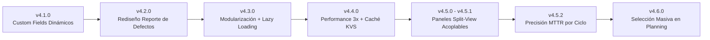

# 📘 Manual de Cambios y Notas de Versión — Test Pulse Suite (`v4.1.0` → `v4.6.0`)

**Versión Actual de la Suite:** `v4.6.0` (Forge Production `v4.111.0` / Development `v6.20.0`)  
**Fecha de Emisión:** Octubre 2026  
**Entorno:** Atlassian Jira Cloud (Forge Native — El Puerto de Liverpool)  
**Audiencia:** QA Engineers, Testers, QA Leads, Scrum Masters y Equipo de Arquitectura/Mantenimiento.

---

## 📑 Índice del Manual de Cambios

1. [Resumen Ejecutivo de Evolución (`v4.1.0` → `v4.6.0`)](#1-resumen-ejecutivo-de-evolución-v410--v460)
2. [Nuevo Sistema de Paneles Acoplables y Vista Dividida (`Split-View`) (`v4.5.0` – `v4.5.1`)](#2-nuevo-sistema-de-paneles-acoplables-y-vista-dividida-split-view-v450--v451)
3. [Mejoras en Planeación (`Planning`): Selección Masiva y Botón `+ Añadir todos` (`v4.6.0`)](#3-mejoras-en-planeación-planning-selección-masiva-y-botón--añadir-todos-v460)
4. [Precisión de Métricas en Informes (`Reports`): Cálculo de `RESOLUCIÓN (MTTR)` por Ciclo y Rediseño de Defectos (`v4.2.0` & `v4.5.2`)](#4-precisión-de-métricas-en-informes-reports-cálculo-de-resolución-mttr-por-ciclo-y-rediseño-de-defectos-v420--v452)
5. [Rendimiento Enterprise, Caché KVS y Blindaje Anti-429 (`v4.4.0`)](#5-rendimiento-enterprise-caché-kvs-y-blindaje-anti-429-v440)
6. [Modernización Arquitectónica: Backend Modular, Code-Splitting y Campos Dinámicos (`v4.1.0` & `v4.3.0`)](#6-modernización-arquitectónica-backend-modular-code-splitting-y-campos-dinámicos-v410--v430)
7. [Historial de Versiones y Puntos de Restauración (Git Tags)](#7-historial-de-versiones-y-puntos-de-restauración-git-tags)

---

## 1. Resumen Ejecutivo de Evolución (`v4.1.0` → `v4.6.0`)

Durante este ciclo de evolución se entregaron mejoras tanto de **experiencia de usuario (UI/UX)** como de **precisión funcional y rendimiento a escala Enterprise**:

| Versión | Categoría | Cambio Principal | Impacto para el Usuario |
| :--- | :--- | :--- | :--- |
| **`v4.6.0`** | 📅 **Planning (UX + Bugfix)** | Reparación de **`+ Añadir todos`** y nueva **Barra de Selección Masiva (`Seleccionar todos`)** | Permite seleccionar todos los casos disponibles con un clic, agregar lotes completos respetando filtros y re-agregar casos previamente eliminados del ciclo. |
| **`v4.5.2`** | 📊 **Reports (Bugfix KPI)** | Cálculo estricto de **`RESOLUCIÓN (MTTR)`** por ciclo filtrado | En ciclos nuevos o sin defectos resueltos muestra **`0d`** en lugar de arrastrar el promedio histórico global del proyecto. |
| **`v4.5.1`** | 🖥️ **UI/UX Global** | **Modo `Split-View` (`Master-Detail`)** integrado en la ventana | Al acoplar paneles a la izquierda o derecha, la lista principal se reacomoda automáticamente lado a lado sin tapar la pantalla ni oscurecer el fondo. |
| **`v4.5.0`** | 🪟 **UI/UX Global** | Selector **`◧ Izquierda` / `▣ Centro` / `◨ Derecha`** en los 4 paneles de trabajo | Disponible en **Diseño**, **Ejecución**, **Defectos** y **Trazabilidad**, recordando la preferencia del usuario. |
| **`v4.4.0`** | ⚡ **Performance Enterprise** | Paralelización de ejecución, caché LRU de evidencias y caché KVS de reportes | Guardado de pasos **~3x más rápido**, carga instantánea de imágenes de evidencia y generación de reportes en **`< 300 ms`**. |
| **`v4.3.0`** | 🏗️ **Arquitectura** | Modularización de *resolvers* en backend y *Code-Splitting* (`React.lazy`) en frontend | Carga inicial más ligera y código organizado por dominios independientes. |
| **`v4.2.0`** | 🐛 **Reports (UI)** | Rediseño ejecutivo de la sección **Reporte de Defectos** | Tarjetas de KPIs de severidad, gráficas de distribución y tabla interactiva más limpia. |
| **`v4.1.0`** | 🔧 **Configuración** | Desacoplamiento de IDs de *Custom Fields* de Jira | Soporte dinámico multi-proyecto con *fallback* automático a los campos de El Puerto de Liverpool. |

---

## 2. Nuevo Sistema de Paneles Acoplables y Vista Dividida (`Split-View`) (`v4.5.0` – `v4.5.1`)

### ¿Qué cambió?
Anteriormente, los paneles de detalle y ejecución se abrían como modales flotantes o *drawers* superpuestos que cubrían parte de la tabla principal con un fondo oscuro (*backdrop*). Ahora, el usuario cuenta con un **selector de acoplamiento de 3 posiciones (`◧ Izquierda` | `▣ Centro` | `◨ Derecha`)** en la cabecera de todos los paneles de inspección y ejecución.

> [!TIP]
> **Preferencia Persistente:** Cuando eliges una posición (`◧`, `▣` o `◨`), Test Pulse Suite guarda automáticamente tu elección en el navegador (`localStorage` bajo la clave `tp_panel_dock_pos`) y la aplica en todos los módulos.

### Modos de Visualización Disponibles

| Icono | Modo | Comportamiento en Pantalla | Caso de Uso Ideal |
| :---: | :--- | :--- | :--- |
| **`◧`** | **Acoplado a la Izquierda (`Split-View`)** | El panel se integra debajo de la barra de navegación (`top: 56px`) del lado izquierdo y empuja el contenido principal hacia la derecha (`padding-left` dinámico). **Sin fondo oscuro.** | Usuarios que prefieren tener el guion de prueba o detalle a la izquierda y la lista de casos a la derecha. |
| **`▣`** | **Modal Central (`Overlay`)** | El panel se muestra centrado frente a la pantalla con bordes redondeados (`16px`) y fondo semitransparente con desenfoque (*backdrop blur*). | Lectura enfocada o edición detallada de un caso de prueba o defecto sin distracciones. |
| **`◨`** | **Acoplado a la Derecha (`Split-View`)** | El panel se integra debajo de la barra superior del lado derecho y ajusta el ancho de la tabla izquierda automáticamente (`calc(100vw - ancho_panel)`). **Sin fondo oscuro.** | **Flujo recomendado para Ejecución y Trazabilidad (`Master-Detail`)**: permite hacer clic de un caso al siguiente en la tabla izquierda mientras se ejecuta o inspecciona a la derecha. |

### Paneles donde está integrado
1. **Diseño de Casos (`Design`)**: Panel de creación/edición de casos de prueba (`renderSlidePanel` en `static/hello-world/src/App.js`).
2. **Consola de Ejecución (`Execution`)**: Inspector de ejecución de casos de prueba, pasos, iteraciones y evidencias (`static/hello-world/src/views/ExecutionView.jsx`).
3. **Inspección de Defectos (`Reports` / `Execution`)**: Panel de detalle y edición en vivo de Bugs (`static/hello-world/src/components/BugSlidePanel.jsx`).
4. **Inspección de Trazabilidad (`Reports`)**: Panel de detalle de Épicas e Historias de Usuario (`static/hello-world/src/components/TraceabilitySlidePanel.jsx`).

---

## 3. Mejoras en Planeación (`Planning`): Selección Masiva y Botón `+ Añadir todos` (`v4.6.0`)

### ¿Qué se corrigió y mejoró?
Al agregar casos de prueba a un Ciclo de Prueba desde el modal **`Add Tests to Cycle`** (pestaña *Available Test Cases*), se resolvieron tres situaciones clave y se incorporó una nueva barra de selección masiva:

1. **Respeto total a la búsqueda y filtros activos en `+ Añadir todos`**:
   - Antes, el botón `+ Añadir todos` tomaba la lista base sin aplicar el buscador de texto (`Search test cases...`).
   - Ahora utiliza `availableFilteredTestCases`, que filtra exactamente los casos visibles que aún no pertenecen al ciclo actual (comparando tanto `id` como `key`).
2. **Re-adición limpia de casos eliminados previamente del ciclo**:
   - Si un caso había sido retirado de un ciclo y luego se volvía a agregar con `+ Añadir todos` o individualmente, podía quedar bloqueado por el registro anti-fantasma (`deletedIdsRef` / `perCycleDeletedRef`).
   - Ahora tanto el botón masivo en `PlanningView.jsx` como `handleAddTestToCycle` en `App.js` limpian tanto `String(tc.id)` como `String(tc.key)` y conservan `folderId`, `testCaseId` y `testCaseKey` en la actualización optimista.
3. **Nueva Barra de Selección Masiva (`Seleccionar todos`)**:
   - Se añadió un **checkbox maestro** en el encabezado de la lista de casos disponibles (con soporte para estado parcial `indeterminate`).
   - Al seleccionar **un solo caso** (o varios), la barra se ilumina automáticamente en azul mostrando:
     - Contador en vivo: **`N de M casos seleccionados`**
     - Botón rápido **`Seleccionar todos (M)`** para marcar de inmediato todos los casos disponibles en la vista actual.
     - Botón **`Limpiar selección`** para desmarcar con un clic.
   - El botón principal cambia dinámicamente entre **`+ Añadir todos (M)`** y **`+ Añadir seleccionados (N)`**.

### Cómo usar el nuevo flujo en `Planning`
1. Abre un ciclo de prueba y haz clic en **`Add Tests`** -> pestaña **`Available Test Cases`**.
2. *(Opcional)* Filtra por carpeta en el árbol izquierdo o escribe una palabra clave en el buscador.
3. Marca cualquier caso de prueba: verás activarse la barra superior con la opción **`Seleccionar todos (M)`**, o bien usa directamente el checkbox maestro del encabezado.
4. Haz clic en **`+ Añadir seleccionados (N)`** (o **`+ Añadir todos (M)`** sin seleccionar) para incorporarlos al ciclo en una sola operación.

---

## 4. Precisión de Métricas en Informes (`Reports`): Cálculo de `RESOLUCIÓN (MTTR)` por Ciclo y Rediseño de Defectos (`v4.2.0` & `v4.5.2`)

### 4.1 Corrección del KPI `RESOLUCIÓN (MTTR)` en Ciclos Nuevos (`v4.5.2`)
- **Síntoma anterior:** Al filtrar el módulo de **Informes (`Reports`)** por un ciclo de prueba recién creado (con `0` ejecuciones y `0` defectos), la tarjeta **`RESOLUCIÓN (MTTR)`** mostraba un valor numérico distinto de cero (ej. `4.2d`) porque leía `reportMetrics.avgResolutionDays` calculado sobre el historial global de bugs del proyecto.
- **Solución implementada (`static/hello-world/src/views/ReportsView.jsx`):**
  - Cuando existe al menos un ciclo seleccionado en los filtros (`reportSelectedCycles.length > 0`), tanto **`RESOLUCIÓN (MTTR)`** (`scopedAvgResolutionDays`) como el gráfico de **Tiempo Promedio de Resolución por Severidad** (`scopedAvgResolutionBySeverity`) se calculan **exclusivamente a partir de los bugs vinculados a los ciclos seleccionados (`filteredBugs`)**.
  - Si el ciclo seleccionado es nuevo o no tiene defectos resueltos con fecha de creación y resolución (`createdAt` y `resolvedAt`), el indicador muestra **`0d`** con total precisión.
  - Cuando no se filtra por ningún ciclo (vista general del proyecto), se conserva la métrica global del proyecto.

### 4.2 Rediseño Ejecutivo del Reporte de Defectos (`v4.2.0`)
- Tarjetas superiores con desglose directo de defectos abiertos vs. cerrados, severidad crítica/alta y acceso directo al panel acoplable `BugSlidePanel.jsx` al hacer clic sobre cualquier fila.

---

## 5. Rendimiento Enterprise, Caché KVS y Blindaje Anti-429 (`v4.4.0`)

Para garantizar tiempos de respuesta inmediatos incluso en proyectos con miles de casos de prueba y decenas de testers simultáneos, se implementaron cuatro optimizaciones de alto impacto:

> [!IMPORTANT]
> Estas optimizaciones reducen hasta en un **65% las llamadas redundantes a las APIs de Jira Cloud**, protegiendo a los usuarios contra errores `HTTP 429 (Too Many Requests)` durante cierres de sprint.

### 5.1 Ejecución de Pruebas (`Execution`) ~3x más rápida
- **Caché de permisos e identidad (`10 min TTL`)**: Evita consultar `/rest/api/3/myself` y `/rest/api/3/mypermissions` en cada clic de estado (`PASS` / `FAIL`).
- **Guardas *No-Op***: Si el paso o caso ya tiene el mismo estado y comentario, se evita reescribir propiedades innecesarias en Jira.
- **Paralelización en Backend (`src/index.js`)**: La actualización de propiedades de ejecución, metadatos del ciclo y auditoría ahora se ejecutan en paralelo con `Promise.all` / `Promise.allSettled`.

### 5.2 Apertura de Ciclos sin Escrituras Fantasma (`Planning` & `Execution`)
- Deduplicación de peticiones *in-flight* al abrir un ciclo y comparación diferencial (`prevCompact` vs `nextCompact`) para que una lectura de sincronización (`getCycleTests`) nunca dispare un `PUT` en segundo plano si los casos no cambiaron realmente.

### 5.3 Carga Instantánea de Evidencias Multimedia (Doble Caché LRU)
- **Backend (`src/index.js`)**: Caché LRU en memoria para binarios de adjuntos (`hasta 40 archivos / 25 MB`, TTL `30 min`).
- **Frontend (`static/hello-world/src/utils/adfUtils.js`)**: Caché LRU de `80 Blob URLs` en el navegador y concurrencia incrementada de `2` a `4` descargas simultáneas. Abrir un paso con capturas de pantalla ya visitadas es instantáneo (`0 ms`).

### 5.4 Caché Compartida de Reportes L1 + L2 (`@forge/kvs`)
- Nuevo motor `src/utils/reportSnapshotCache.js` que almacena snapshots comprimidos y fragmentados en **Memoria (L1)** y **Forge KVS (L2, TTL 3 minutos)**.
- Cuando un miembro del equipo genera el dashboard de `Reports`, los demás usuarios que consulten el mismo proyecto obtienen la respuesta en **`< 300 ms`**.
- **Invalidación reactiva automática**: Cualquier cambio en casos, ejecuciones, carpetas o ciclos incrementa la versión del proyecto (`bumpProjectReportVersion`) para asegurar que nunca se muestren datos obsoletos.

---

## 6. Modernización Arquitectónica: Backend Modular, Code-Splitting y Campos Dinámicos (`v4.1.0` & `v4.3.0`)

1. **Desacoplamiento de Custom Fields (`src/utils/customFieldConfig.js`) (`v4.1.0`)**:
   - Centralización de los IDs de campos personalizados (`10530` a `10570`, `10014`) en un único módulo configurable por proyecto en Forge Storage, manteniendo como *fallback* por defecto los IDs productivos de El Puerto de Liverpool.
2. **Modularización de Resolvers en Backend (`src/resolvers/`) (`v4.3.0`)**:
   - Extracción limpia desde `src/index.js` hacia 5 módulos especializados:
     - `src/resolvers/configResolvers.js`
     - `src/resolvers/bugResolvers.js`
     - `src/resolvers/folderResolvers.js`
     - `src/resolvers/reportAutomationResolvers.js`
     - `src/resolvers/mobileCompanionResolvers.js`
3. **Code-Splitting en Frontend con `React.lazy` y `<Suspense>` (`v4.3.0`)**:
   - Carga diferida bajo demanda de las vistas pesadas (`ReportsView.jsx`, `ExecutionView.jsx`, `PlanningView.jsx`, `SettingsView.jsx`) y paneles secundarios, reduciendo el peso del bundle principal (`main.js`) en más de `145 KB`.

---

## 7. Historial de Versiones y Puntos de Restauración (Git Tags)

Todos los cambios cuentan con puntos de restauración etiquetados en el repositorio Git por si se requiere auditar o comparar cualquier etapa:

| Etiqueta Git / Versión | Descripción del Hito | Estado |
| :--- | :--- | :---: |
| `backup-v4.0.2-pre-modernization` | Punto de restauración previo al inicio del plan de modernización v4 | ✅ Respaldado |
| `backup-v4.2.0-pre-1b` | Respaldo con Custom Fields dinámicos (`v4.1.0`) y Rediseño de Defectos (`v4.2.0`) | ✅ Respaldado |
| `v4.3.0-stage-1b` | Backend modularizado en `src/resolvers/` + Frontend con `React.lazy` | ✅ Respaldado |
| `v4.4.0-enterprise-scale` | Optimización de velocidad 3x, doble caché LRU de evidencias y caché KVS de reportes | ✅ Respaldado |
| **`v4.6.0` (`HEAD / main`)** | Paneles acoplables `Split-View` (`v4.5.0`–`v4.5.1`), corrección de `MTTR` por ciclo (`v4.5.2`) y Selección Masiva + `+ Añadir todos` en Planning (`v4.6.0`) | 🚀 **Activo en Producción (`v4.111.0`)** |
